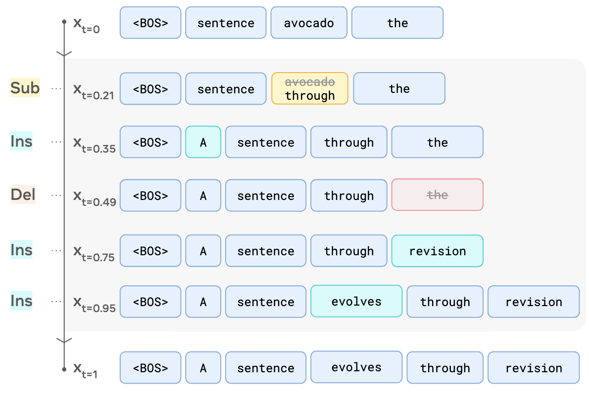

# Edit Flows for the extended coupling of known target sequences

A discrete edit flow that learns to *delete*: the source sequence is a known target sequence with random
letters inserted at random positions, and the model has to find and remove exactly those letters. The code
is a fork of [Marten Lienen's Edit Flows implementation](https://github.com/martenlienen/edit-flows)
(see [Upstream](#upstream) below) with a 20-letter alphabet, a sequence-file dataset, the extended
coupling, a swappable sequence encoder and an evaluation built around the confusion matrix of the delete
operation.

| | |
|---|---|
| vocabulary | the first 20 letters `A`-`T` (ids 0-19) plus a BOS token (20); no padding, batches are packed |
| targets $x_1$ | known sequences, one per row of an `.xlsx` / `.csv` / `.txt` file (100-500 letters) |
| sources $x_0$ | the target with $K = \operatorname{round}(n_1 (1/f - 1))$ uniform letters inserted at uniform positions; the *original fraction* $f \sim U(f_\min, f_\max)$ per sequence |
| alignment | known from the construction (pure deletions), no search |
| model | time-blind sequence encoder (placeholder: a small Llama trunk) + edit-flow head (insert / substitute / delete rates and token logits) |
| objective | the Edit Flows Bregman divergence on the token-wise mixture path (unchanged from upstream) |
| evaluation | per epoch: confusion matrix, precision, recall and F1 of the delete operation, bucketed by target length and original fraction; insertion / substitution events; a ranking proxy at $t = 0$ |

## Quick start (CPU, any machine)

```bash
# environment: see docs/DEPENDENCIES.md (Python 3.13, torch 2.13.0)
pip install -r requirements-cpu.txt

python scripts/make_synthetic_targets.py --n 20000 --out data/synthetic/targets.xlsx   # placeholder targets
python -m pytest -q tests -m "not slow"                                                 # ~10 s
python train.py experiment=deletion-smoke                                               # ~1 min, runs/smoke/
python train.py experiment=deletion-local                                               # ~40 min, runs/local/
python evaluate.py runs/local/checkpoints/last.ckpt -n 128 --show 4                     # annotated examples + table
```

`scripts/smoke_local.ps1` / `scripts/smoke_local.sh` run the first four steps in one go. The walkthrough
notebook `notebooks/walkthrough.ipynb` explains every part of the pipeline on the `runs/local` results
(CPU only, kernel `editflows_env`).

Training on GPUs and SLURM clusters: [docs/CLUSTER.md](docs/CLUSTER.md).

## How it fits together

```
config/                 hydra configuration (groups: data, task/{model,coupling,aligner,noise,path,...}, logging, experiment)
train.py                hydra entry point: datamodule + task + lightning Trainer, run directory, auto-resume
evaluate.py             sample from coupled held-out targets, print the confusion matrix per bucket
editflows/
  editflows.py          upstream core: DataBatch, aligners, probability path, EditFlow loss and Euler sampler
                        (+ optional provenance `origin` carried through the edit operations)
  coupling.py           ExtendedCoupling, KnownAligner, NullSource
  encoder.py            SequenceEncoder interface + LlamaEncoder placeholder
  edit_head.py          EditFlowHead (time embedding, rates, logits) + EncoderWithEditHead
  data/sequences.py     SequenceFileDataModule (file -> ids, cache, split, epoch-based loaders)
  metrics.py            Buckets, DeletionCounts, CSV / JSON writers
  deletion_task.py      DeletionTask(Pretraining): validation / test epochs with the deletion metrics
  pretraining.py, llama.py, data/text8.py, ...   upstream modules, unchanged
scripts/                synthetic data, SLURM job template + chaining, local smoke scripts
docs/                   DEPENDENCIES.md, CLUSTER.md
tests/                  upstream unit tests + coupling, model, provenance, metrics, data and train smoke tests
```

The data workers build the source of every target (`ExtendedCoupling`) and its alignment (`KnownAligner`);
the Lightning module computes the loss exactly as upstream (`Pretraining.training_step`). After every
epoch `DeletionTask` samples from the sources of a fixed validation subset with provenance tracking and
counts, per source token, whether it was deleted or kept against whether it had been inserted.

## Runs and metrics

Every run lives in `runs/<name>/` (`config.yaml`, `train.log`, `logs/version_N/metrics.csv`,
`eval/deletion_metrics.csv`, `eval/val_epoch_NNNN.json`, `checkpoints/`). Starting the same name again
resumes from the newest checkpoint.

| metric | meaning |
|---|---|
| `del_precision`, `del_recall`, `del_f1` | of the delete operation at the end of sampling: TP = inserted token deleted, FP = original token deleted, FN = inserted token kept |
| `del_chance` | precision of deleting at random = share of inserted tokens |
| `rank_p_at_k` | at $t = 0$, share of insertions among the $k$ source tokens with the highest deletion rate ($k$ = number of insertions) |
| `ins_per_seq`, `sub_per_seq` | spurious insertion / substitution events per sequence (the model is free to use them, the data never needs them) |
| `exact_match`, `len_err` | sequence-level: sample equals the target; mean absolute length error |

All of them are reported overall and per bucket of target length x original fraction
(`task.eval.target_len_bins`, `task.eval.fraction_bins`).

## Changing the pieces

* **Real target sequences:** point `data.path` at the file; the loader needs one sequence per row. Letters
  outside `data.alphabet` raise an error.
* **Real sequence encoder:** implement `editflows.encoder.SequenceEncoder` (`DataBatch -> (n, hidden)`
  tensor, attribute `hidden_size`) and select it in the `encoder` node of `config/task/model/encoder-head.yaml`.
* **Coupling strength:** `task.coupling.original_fraction=[0.5,0.5]` for a fixed share.
* **Model size / schedule:** see `config/experiment/deletion-base.yaml`.

## Upstream

This repository is a fork of Marten Lienen's `edit-flows`, whose README follows. His text8 language
modelling pipeline (`data=text8 task=pretraining`) is still in the tree but its dependencies
(`sentencepiece`, `datasets`, `loky`) are no longer installed by default.

---

# Language Modeling with Edit Flows

A well-documented and typed PyTorch implementation of Edit Flows by Marten Lienen.

Edit Flows is a generative model for variable-length sequences described in [Edit Flows: Flow Matching with Edit Operations](https://arxiv.org/abs/2506.09018) by Marton Havasi, Brian Karrer, Itai Gat and Ricky Chen. I intend this repository to serve as the basis for further research with a working, albeit minimal, language modeling pipeline. The code in [editflows.py](./editflows/editflows.py) is a self-contained implementation of the model that can be dropped straight into other projects. Integrating it into a training framework requires just a small wrapper, for example [pretraining.py](./editflows/pretraining.py) for PyTorch Lightning.

This repository has served as the basis for the following papers and projects:
1. [Edit-Based Flow Matching for Temporal Point Processes](https://arxiv.org/abs/2510.06050) by David Lüdke\*, Marten Lienen\*, Marcel Kollovieh, Stephan Günnemann

If you build on this code, please let me know and I will add your project above.

<p align="center"><br />The Edit Flows sampling process (Figure 1, <a href="https://arxiv.org/abs/2506.09018">Havasi et al.</a>)</p>

## Results

I have trained a Llama 2 model on [text8](https://mattmahoney.net/dc/textdata.html) to verify the implementation. The model has about 180M parameters and trained on 4 A100s for 100k steps in about 10 hours.
```
$ ./sample.py -n 2 --seed 55 ./text8.ckpt
records supposing that us and u s were too avoided firing on the occasion the issue marked how much the french worked more on the issue some feel that they still is the very occasion they saw the united states s ships of which could become a carrier on their own islands with the british but the military itself announced the eight zero zero zero month army road national fleet went because france intended that roads would be all the time to break

oc the protection itself in the two ways all economic or religious pure can imply a political perspective notably in the language debekara p four three zero like is the sense of like it is such and does not appear to have the extent of effective or uncertain all its response must be verbrella the parma hogana dutch middleme journers arher or ed wood see also fugure fathers external
```
Of course, this is far from actual English, but it is sufficiently close for me to call it working. If you train the model for longer or on larger data, let me know!

To replicate the sample above, either download the checkpoint with
```
curl -L -o text8.ckpt https://huggingface.co/martenlienen/edit-flows/resolve/main/text8.ckpt
```
or create one yourself with
```
./train.py experiment=text8-180M
```

## Installation

We use [pixi](https://pixi.sh/) to easily set up reproducible environments. Install it with `curl -fsSL https://pixi.sh/install.sh | bash`, then install and activate the environment with

```sh
pixi shell
```

This gives you a GPU environment by default. For a machine without a GPU, activate the CPU environment instead with `pixi shell -e cpudev`.

## Training

Training is configured with [hydra](https://hydra.cc), so you can override any setting from the command line and browse the defaults in the [`config`](./config) directory. The datamodule downloads the text8 dataset and prepares the tokenizer automatically on the first run, so you can just start a training.

Any setting can be overridden inline, for example the batch size or the number of steps

```sh
./train.py experiment=text8-180M data.batch_size=256 trainer.max_steps=50000
```

Training logs to [Weights & Biases](https://wandb.ai) by default. To log to a local CSV file instead, add `logging=csv`.

Self-contained checkpoints are written to `checkpoints/<run-name>/<run-id>/`: in addition to the weights, each one also stores the model configuration and the SentencePiece tokenizer.

## Sampling

You can sample sequences from a trained model with

```sh
./sample.py -n <samples> path/to/file.ckpt
```

For more options, check [sample.py](./sample.py) or run `./sample.py --help`.
